# Explicit kernel-guard recovery laboratory — issue #43

This follows PR42 on `rebuild-2026-11-11`. It remains in the separate runtime lab:
no product interface, public-site adapter, release signing or publication.
The previous 27 original +27 UID tests and the original observer-loss refusal
case are retained. CI execution of the new contract is required; local compilation
and a passing Linux reference test do not establish Android acceptance.

## Contract

Normal `submit` still returns CLEANUP_FAILED for an uncertain reservation. Recovery
is an **explicit** owner action, never a timer-based reset. A failed operation's
missing proc-death evidence is not retrospectively changed into `death_confirmed`.

The owner creates a private zero-length, mode0600 regular file and acquires Linux
`flock(LOCK_EX|LOCK_NB)` on a read-only descriptor. Binder transfer, fork and dup
preserve the same open file description. The native child receives it at fd6;
other inherited descriptors remain closed. Before Python, an additional irreversible
filter rejects all flock and POSIX/OFD lock-changing fcntl operations (including
unlock through a duplicate), close
of fd6, dup2/dup3 replacement of fd6 and all close_range variants. Existing clone,
exec, io_uring, signal, credential and supervisor protections remain. Native
bootstrap probes require the real denials before the owner arms the journal.

Denial probes use raw syscalls. A bootstrap-only SIGSYS handler accepts only a
kernel `SYS_SECCOMP` trap for the exact in-flight denied syscall. Android's
pre-existing seccomp TRAP has higher precedence than the additional ERRNO filter;
an arbitrary signal or process exit never counts as denial evidence. The previous
handler is restored before Python, including the existing dedicated credential
negative test. Fixed protocol stages and `GUARD_KERNEL_SIGSYS_MASK` record which
bootstrap probes encountered platform traps without exposing code, URLs or paths.
The Linux reference also tests an overriding TRAP and rejects a non-kernel SIGSYS.

A small owner-only libc JNI helper performs nonblocking flock acquisition and
checks owner UID, exact device/inode, regular zero-length type, mode0600 and one
link with O_NOFOLLOW. It never loads libpython, accesses a worker PID or reads keys.
The child and its trusted supervisor still share one isolated UID/MCS category;
the normal application UID remains separate.

```mermaid
stateDiagram-v2
    [*] --> RESERVED: persist identity before bind
    RESERVED --> ARMED: fence proven; durable write before Python ACK
    ARMED --> REAPED: positive exclusive kernel lock
    REAPED --> [*]: remove guard and durable reservation
```

`uncertain` is an orthogonal durable flag. Observer loss keeps ARMED and marks
uncertainty. Ordinary submit remains refused. Explicit recovery verifies:

- Valid same-boot schema and immutable operation/file identity, with an ARMED
  reservation (or an already committed REAPED crash-cleanup state).
- No unfinished owner preparation, callback or HTTPS task; no old ServiceRecord.
  A changed owner PID must additionally have a positively established old task
  exit/reused start identity. Denied or malformed proc reads do not prove death.
  A zombie owner group leader is also insufficient: other threads can still run.
  Its proc identity must disappear or change before recovery can proceed.
- The owner's unique canary still exists and matches the interrupted operation.
- A separate open file description obtains **exclusive nonblocking flock** on
  the exact inode. Every guard reference in transit, supervisor and native child
  must have released the locked description. This proof, not Binder/PID absence,
  authorizes recovery.

REAPED is atomically persisted while holding the exclusive proof, before unlinking
the guard and deleting the reservation. A process crash between these steps can
finish cleanup without fabricating a new guard. Admission is serialized across
Runtime instances; journal cleanup cannot reset a newly admitted operation's flag.
Atomic fsync is outside the Runtime monitor used by UI cancellation.

## What remains blocked

Legacy reservations, unarmed interrupted startup, missing/replaced guard files,
changed canaries, invalid schema, unknown owner existence, lock contention and
unfinished owner I/O remain refused. A readable older-boot reservation can be
retired after real BOOT_COUNT advancement; an unreadable/corrupt journal is not
silently erased. There is no unconditional "reset" API.

The proof depends on a trusted owner/supervisor/bootstrap, Android UID/SELinux
protection of the private pathname and Linux local-filesystem flock semantics.
It is not protection against root/kernel/ART/bootstrap compromise or an attacker
already controlling the normal application UID. Disk IO/fsync is not guaranteed
to meet a hard real-time deadline; failure preserves refusal. Child cancellation
and request deadlines retain their independent supervisor enforcement.

RSS remains sampled, not an instantaneous hard cap. Zip/memfd/file-cache storage
and the main owner's memory are additional to child RSS. No laboratory number is
promoted into a product budget.

Resource preparation remains inside the unchanged operation deadline. Digest
encoding uses a fixed nibble lookup instead of allocating a Formatter for every
byte of every asset hash. The lowercase SHA-256 representation and all inventory
checks are unchanged; this reduces preparation work without extending deadlines
or warming up Python outside the measured operation.

## Additional tests and SDK-free QA

The old observer-loss test runs unchanged and must still refuse ordinary reuse.
Only afterward do four additional instrumentation cases check explicit prior-loss
recovery, live-lock denial, malformed/missing/inode/canary/legacy/unarmed fixtures,
repeated supervisor loss and actual QA controls. A separate CI driver launches a
normal owner, waits for Python-started UI and an ARMED journal, verifies its own
PID/start/name and kills only that owner. A fresh instrumentation process must
recover through the real guard and complete a new owned HTTPS analysis. Outside
shell observations do not clear the app reservation.

Owner termination uses the debug launcher's confirmed, guarded **self-SIGKILL**;
it never accepts a PID, cancels work, unbinds the Service or edits the reservation
first. The driver independently confirms owner exit before instrumentation starts.
It uses neither a shell signal nor force-stop. Old-owner proc reads use the public
Os API to preserve typed errno on API26: only ENOENT/ESRCH or a changed start identity
prove exit; EACCES/EPERM/malformed records still refuse recovery.

The existing matrices remain API26/29/35 with4KiB and official API36 rev7 with
actual16KiB, both ABI source builds and all41 product API35, Windows/JVM/Lint/policy.
`recovery_report.py` adds its own strict acceptance; it does not replace the27+27
gates. Failure screenshots/window/activity/UI dumps and separate infrastructure
classification remain required.

The separate **TheKaiN UID QA** launcher adds:

1. **Сбой наблюдателя и восстановление**: fixed supervised hang, actual observer
   teardown, original CLEANUP_FAILED without death proof, explicit kernel proof,
   and fresh owned analysis. The old failure stays recorded.
2. **Восстановить после перезапуска**: explicit recovery after an interrupted
   owner. A missing/busy/unverified proof never enables a new analysis.

For physical testing, first run the original14-case suite, then the recovery
trial. For owner restart, start the hang, wait for Python's PID, choose **Завершить
процесс QA** and confirm **Завершить QA** in the separate lab, reopen it and choose
explicit recovery.
Export the JSON; original cases and separate recovery trials remain distinguishable.
An operator report is editable evidence, not device attestation.

The supplied Samsung SM-S928B/Android17 reports for reviewed431f7b1 matched its
source/APK/certificate receipt and16 expected cases, with15 native instances and
five fresh owned analyses after faults. They establish bounded **previous UID
backend** evidence; this new recovery contract on physical ARM64 is **NOT_RUN**.
Do not reuse that old source's acceptance for this change.

Separate OPEN tasks: APK89 independent review#38, Windows callback race#39,
prolonged physical background#40 and deep Doze#41. Main, branch rules, protected
keys, release and QA gates stay unchanged. Request fresh KaiN1One review only
after successful final-HEAD CI. No merge before independent approval.
