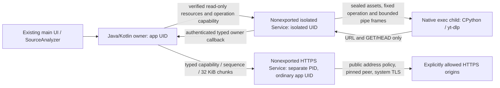

# C2: isolated SourceAnalyzer in the existing main APK

Issue #53, based on approved PR52 merge
`11fa103624275958f089d9566c7722fc64133094`. This is an explicit **internal debug
integration build**, not a new application or a completed personal-use release.
`production_ready=false`; `automatic_publication=false`.

## Implemented boundary



The shared runtime is compiled from its existing sources by `runtime-core`; it
is not copied into another implementation. Only the isolated Service is declared
in the main APK; the old shared-UID Python Service remains absent. Parent and
HTTPS process never load CPython. The isolated Java observer remains non-dumpable;
Python executes in its fenced native child, with the existing irreversible
kernel lease, resource counters, RLIMIT_AS/CPU and parent-death behavior.

The network Service **shares the app UID** and therefore remains trusted code
with the app's filesystem permissions. It is not a sandbox for untrusted Java or
native code. Python has a separate isolated UID and never receives this Service's
Binder, origin grants, TLS roots, writable descriptors, caller headers, cookies,
or app paths. A compromise of the OS, trusted owner/broker code, or platform TLS
implementation remains outside the address-policy guarantee.

`TheKaiNApp` starts Room, recovery and WorkManager application work only in the
exact main process. Secondary and isolated Service Application startup performs
none of that owner initialization. Owner-only lease JNI and isolated-process
identity checks explicitly recognize the two known package identities; they do
not accept arbitrary process names or app IDs.

## HTTPS IPC, deadlines and cleanup

`IRemoteHttps` uses fixed bounded Parcelable schemas. The explicit nonexported
component and actual Binder UID/PID authenticate the main owner. A hello is
matched against kernel PID/start/name and absence of libpython; an unguessable
operation ID, monotonically increasing request sequence and exact offsets bind
every response. Chunks are at most **32768 bytes**. Total response allocation
remains bounded to 512 KiB; aggregate payload to 2 MiB; attempts to 12. There are
no Bundles, serialized arbitrary objects, scripts or remote resource updates.

Configuration and retirement use synchronous Binder calls off the UI/supervisor
threads: Android reports PID 0 for cross-process `oneway` calls, which cannot
satisfy exact-owner PID authentication. RSS comes from kernel `VmRSS` with explicit
kB-to-byte conversion, never `stat` page counts multiplied by a libc/compatibility
page size. Resource thresholds and operation deadlines are unchanged.

The C1 broker executes wholly inside this disposable HTTPS PID, including its
two interruption-resistant DNS slots. Origin, DNS-answer, pinned-socket,
IPv4/IPv6/private/metadata, redirect, system CA/hostname, framing and encoding
rules from [CONTROLLED_HTTPS.md](CONTROLLED_HTTPS.md) remain mandatory. Redirects
can cross only origins explicitly granted by trusted owner configuration.
Only selected real response metadata (final URL, Content-Type, Content-Length
and status) crosses the native bridge; no fabricated HTML response header is
used for this source path. Legacy fixture transport stays unchanged.

The exact original monotonic operation deadline includes preparation, process
startup, DNS, TLS, reads and result acceptance. It is passed to the broker, never
restarted on bind, redirects or IPC chunks. Cancellation/retirement atomically
closes admission and rejects late responses. The lifecycle supervisor runs
separately from blocking Binder handshakes and fetches. It samples actual kernel
RSS/CPU and kills the exact owned network PID on deadline, cancellation, crash
or resource violation. It never uses an unverified/reused PID as a kill target.

Cleanup requires **kernel process absence or changed start identity**, dead
Binder, absent ServiceRecord, drained owner helper work and acquisition of the
matching file guard. A zombie leader, permission failure, canceled Future or
missing callback cannot grant cleanup. A trusted network Service retains its
read-only flock descriptor until process exit; it never closes that guard ahead
of potentially stuck DNS threads. Owner death also causes the Service to kill
itself. Ordinary retirement waits at most the existing 2.5 s; uncertainty poisons
admission instead of allocating replacement workers. Explicit recovery requires
the prior owner to be gone (or the same owner's work drained), no Service and a
free matching kernel guard. Interrupted history is not rewritten as a timeout.

The network guard relies on trusted Service code retaining its descriptor;
unlike the untrusted native child's guard it is not an irreversible seccomp
fence. Normal retirement additionally proves whole-PID absence independently.
Network CPU/RSS sampling and process killing are not instant cgroup limits.
Candidate internal defaults are 384 MiB sampled RSS and 10 s consumed CPU after
hello, bounded also by the shared 30 s maximum deadline. They are **not physical
device/product thresholds**; the fault tests use lower explicit values. Both
roles' measured counters and retirement latency are retained in evidence.

Read-only guard checks use kernel FD flags through a tiny libc-only JNI query and
a real read, avoiding the API30-only public `Os.fcntlInt` on API26/29. The separate
helper permits only the exact broker process; owner-only lock JNI remains owner-only.
No write changes the guard. Resource verification now checks cancellation/deadline
while reading, hashing and writing asset chunks, and cleans interrupted ZIPs.

## Typed source result and current product scope

Only fixed `SOURCE_ANALYZE` dispatch is available through `analyzeSource`.
The old shared-UID backend rejects that operation. Existing APK inventories
verify every resource before transferring a read-only unlinked ZIP; the isolated
Service rehashes and seals it before exec. The source path does not install a
mutable Python cache or transfer fixture TLS keys; fixed sealed sentinels retain
the old FD layout without providing credentials.

The pinned existing yt-dlp performs genuine generic/HTML5 extraction over the
approved transport. Plugins, JS runtimes, remote components, subprocesses,
postprocessors, playlists, DRM and media downloading remain disabled. A separate
normalizer emits title, host and at most eight actual MP4 candidate declarations:
URL/id, codecs, optional bytes, dimensions and FPS. The combined text budget is
4096 characters; the existing entire typed result's 16 KiB parcel cap is unchanged.
Malformed, credential-bearing, cross-origin, unsupported and oversized metadata
fails; unknown values remain null/unknown. No raw extractor JSON reaches the UI.

The source path specifies a single-format selector explicitly. yt-dlp's default
selector probes external FFmpeg even for analysis-only extraction; the installed
audit hook correctly rejected that in run259. The explicit selector avoids the
probe without relaxing audit/seccomp. A fresh host interpreter installs the real
audit hook, proves subprocess denial and performs real pinned generic extraction
as a regression test. This neither adds FFmpeg nor authorizes media transfer.

The main `IsolatedSourceAnalyzer` uses authoritative read-only outcome signals,
checks worker UID/death/canary/fence proof and validates every candidate against
the trusted scope. Evidence is tied to the exact operation's transport, never a
global latest-result pointer. UI cancellation cannot deliver a stale result;
cleanup may continue under the existing closed admission gate. A UI timeout can
cancel the operation before its independent runtime deadline wins: evidence
records the actual acknowledged cancel or timeout, with mandatory death proof.
It never accepts absent/unknown results as successful timeouts.

The ordinary build still uses `HttpsSourceAnalyzer`. The explicit internal main
build routes only the immutable repository-owned test page at its compiled source
commit through the isolated analyzer. All other direct/static paths retain the
existing behavior. There is no end-user switch granting arbitrary sites. Existing
direct HTTPS downloads, Room, staging and MediaStore are retained. New candidates
are inspectable but **download-disabled**, enforced by both application state and
UI. Track/transfer/mux acceptance belongs to stage D. No YouTube support is claimed.

## Building, dependencies and reproducible checks

Build the pinned native package with the existing source builder, then:

```sh
gradle --no-daemon -p rewrite/android \
  -PisolatedRuntimeDir=/absolute/path/to/verified/package \
  :app:testDebugUnitTest :app:assembleDebug :app:assembleDebugAndroidTest
gradle --no-daemon -p rewrite/android \
  -PisolatedRuntimeDir=/absolute/path/to/verified/package :app:lintDebug
```

The property includes `runtime-core`, its sources/manifest/assets, and the internal
main source/test directories. It restricts this APK to ARM64/x86_64 and refuses
release tasks. Without the property, neither core nor native resources nor the
internal routing/tests are included. The default lockfile remains unchanged;
the internal variant has its own generated `gradle-isolated.lockfile`.

No new third-party artifact/version is introduced: the same reviewed/pinned
OkHttp 4.12.0 / Okio 3.6.0 is promoted only into this internal debug path. The
effective **app** debug dependency inventory records resolved versions, hashes,
licenses and sources (including the app's existing Kotlin version). Source-built
native notices remain packaged. AndroidX graphics-path 1.0.1 is the existing
baseline native dependency; its effective AAR native hashes are recorded too.
`main_delivery.py` requires exact same-run source, debug certificate, package/SDK,
versionCode3, assets, expected ELF set/hashes and actual 16 KiB ELF/ZIP alignment.
This receipt is not independent APK89 verification or protected signing approval.

CI retains all original **73** laboratory gates, all **41** main API35 tests,
API26/29 storage/direct, JVM/Lint, Windows-host and CI-policy. Additional checks:

* Five real remote-broker tests, including 32 KiB chunks, replay/capability,
  DNS cancel/deadline, crash, measured CPU/RSS retirement, exact public TLS MP4,
  schema and external-UID rejection; fresh process after each failure.
  DNS fault injection really blocks a resolver thread and ignores interruption;
  it is not a claimed reproduction of a vendor-specific DNS outage.
* Explicit intentional owner SIGKILL during confirmed stuck DNS. A unique attempt
  nonce and fsynced marker bind the setup; the driver independently proves both
  old PIDs absent before a separate successful guarded recovery test. A missing
  result/timeout is not considered a passed crash preparation.
* Four tests in the **actual main package**: public owned-page AppGraph analysis
  and preserved direct path; actual HTTP cancel/deadline and recovery; asset/
  pre-Python cancellation; TLS/scope refusals and recovery.
* One actual main UI test: paste owned page, analyze, inspect real candidate,
  verify disabled unchecked transfer and capture the displayed preview PNG.

Thus each API26/29/35/36 actual16KiB target executes original73 + new6 lab gates
and five main tests (**84 unique successful tests**, with the intentional crash
setup explicitly separate). The independent probe APK checks both main Services
and absence of a shared-UID Python Service. Strict source/API/pages-bound intake
requires every record and actual result. Failure capture retains original window
focus, Activity, hierarchy/screenshot evidence and adds the main UI evidence.
The new boundary runs after the isolated JNI bootstrap and before the lengthy
original suite, so a failed handshake produces evidence promptly. All original
73 checks still execute and must pass before the matrix job can be successful.
Initial run255 API26 stalled in emulator/ADB boot before any test and exhausted
the job limit. Boot polling now bounds each ADB request within the existing 360s
polling budget and reports `INFRA_BOOT_NOT_READY` separately. This does not extend
an application deadline or turn an unexecuted test into a pass.

Exact final source HEAD, CI runs, resource measurements and any failures belong
in the PR after execution. Local compilation or a source-built ARM64 library is
not ARM64 execution. Current-source physical ARM64 remains **NOT_RUN**; Samsung
#46 full acceptance remains **BLOCKED/unconfirmed**, with no unchanged phone rerun.
Keep #38 APK89, #39 Windows race, #40 prolonged background, #41 deep Doze, #43
physical acceptance and #45 API35 ANR open. Default release packaging, main,
protections, signing keys and publication remain unchanged. Independent exact-HEAD
KaiN1One review is required after successful CI; no merge before that approval.
